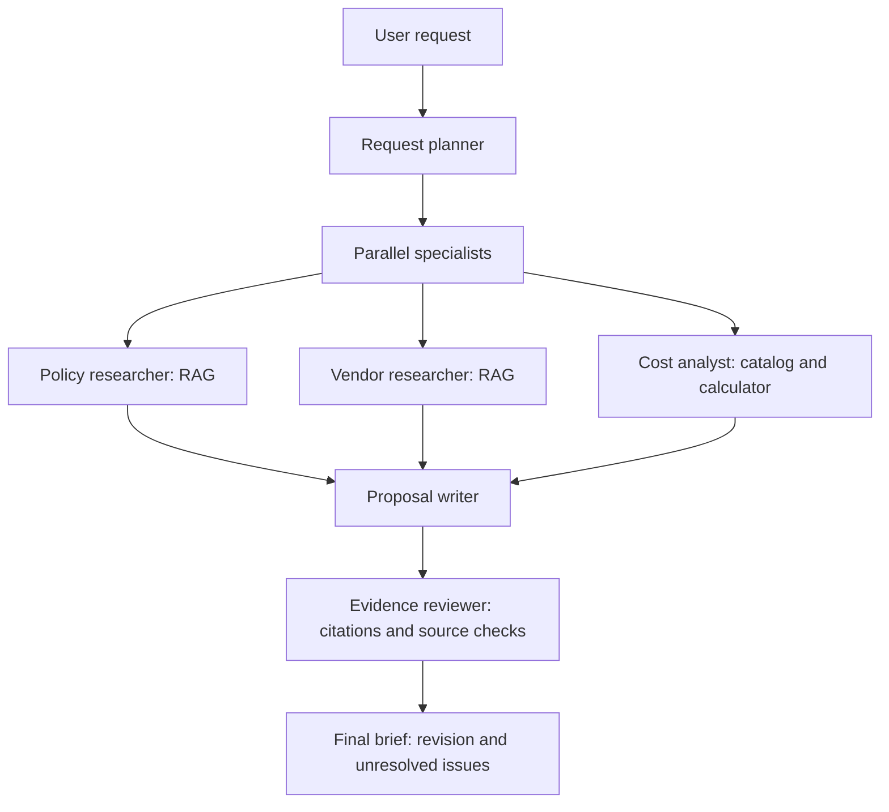

# Enterprise RAG demo — procurement solution team

A complete, fictional procurement workflow demonstrating **specialist subagents, parallel execution, RAG, deterministic tools, shared session state, evidence review, and revision** in Google ADK.

Ask the team to compare software vendors under a budget and security constraints. It researches internal policies and vendor proposals, computes quotes, and produces a cited recommendation with approval steps and unresolved questions. It never places orders or grants approvals.

## Start the demo

From the repository root, activate your environment and configure Gemini access:

```bash
source .venv/bin/activate
export GOOGLE_GENAI_USE_VERTEXAI=FALSE
export GOOGLE_API_KEY="YOUR_GOOGLE_API_KEY"
export ENTERPRISE_RAG_MODEL="gemini-3.5-flash"
cd enterprise_rag_demo
adk web
```

Select **solution_team** in the ADK web interface. Use a model available to your account; the environment variable above overrides the default. Terminal alternative: `adk run solution_team` from this directory.

Install `google-adk` if needed, following the root README. Python 3.11 or newer is recommended. Retrieval and calculations use only the standard library; no vector database or embedding service is required.

## Example request

```text
We need a customer-support knowledge tool for 25 employees for 12 months.
Our total budget is INR 350,000 excluding tax. We process customer data,
so SAML SSO, India-only storage including backups, role-based access,
audit logs, and deletion within 30 days are mandatory.
Compare Atlas, Beacon, and Cedar. Recommend a candidate if appropriate,
show the full-term costs, cite the evidence, explain approval requirements,
and identify anything we still need to verify before purchasing.
```

Expected facts to look for:

| Vendor | 12-month total for 25 seats, before tax | Important evidence |
| --- | --- | --- |
| Atlas | INR 290,000 | Vendor states SAML SSO and India-only content/backups |
| Beacon | INR 260,000 | Backups are in Singapore; fails the stated residency constraint |
| Cedar | INR 340,000 | SAML SSO is not supported |

Atlas is a **conditional candidate**, not an approved purchase. Manager and Finance approvals are required for its INR 290,000 commitment under the current policy. Completed security review and a signed data processing agreement are missing from the evidence. No independently verified vendor certifications are provided.

The archived policy has a different approval threshold. The team should identify that it is explicitly superseded, rather than use whichever threshold is convenient.

## Workflow



The root is a `SequentialAgent`. Its second stage is a `ParallelAgent` containing three independent specialists. Seven LLM agents run overall: planner, three specialists, writer, reviewer, and final editor. Specialist tool calls can require additional model requests.

Each agent writes its result to a distinct `output_key` in session state:

| Stage | State key | Responsibility |
| --- | --- | --- |
| Planner | `request_plan` | Extract requirements and identify missing inputs |
| Policy researcher | `policy_evidence` | Retrieve mandatory rules and approval thresholds |
| Vendor researcher | `vendor_evidence` | Retrieve feature claims and gaps |
| Cost analyst | `cost_analysis` | Calculate comparable full-term quotes |
| Writer | `proposal_draft` | Combine evidence into a decision brief |
| Reviewer | `review_findings` | Audit citations, supported claims, and calculations |
| Final editor | `decision_brief` | Apply corrections and disclose remaining issues |

Parallel specialists read the same plan and write different keys. They do not depend on each other's in-progress outputs. The writer starts after all three complete. Every turn runs the full pipeline and overwrites these working keys; this is session context, not durable memory across sessions.

The framework fixes stage order; each researcher chooses searches, query reformulations, and context reads within its stage. See the official [sequential workflow documentation](https://github.com/google/adk-docs/blob/main/docs/agents/workflow-agents/sequential-agents.md) and [multi-agent patterns](https://developers.googleblog.com/en/developers-guide-to-multi-agent-patterns-in-adk/) for the ADK mechanisms used here.

## Inspect the workflow

1. Submit the main prompt and inspect events for each named agent.
2. Expand `search_knowledge` calls to inspect retrieved passages, relevance scores, and line citations.
3. Inspect `calculate_quote`: financial totals come from code rather than model arithmetic.
4. Compare the three specialist outputs and their state keys.
5. Inspect the reviewer's `validate_citations` call and source reads.
6. Compare the draft, review findings, and final brief.

Depending on your ADK version, intermediate agent messages may appear in chat as well as event traces. Exact tool sequences and generated wording vary.

## Additional scenarios

**No eligible vendor under budget**

```text
Use the same 25-seat, 12-month customer-data requirements, but cap the
budget at INR 280,000 before tax. Is any proposal both eligible and affordable?
```

Atlas exceeds budget; the cheaper Beacon still fails residency. The team should not silently relax mandatory requirements.

**Minimum-seat billing**

```text
Compare the cost of all three vendors for 2 seats for 1 month with a
budget of INR 60,000 before tax. Show requested versus billed seats.
This is only a price exercise; do not assume security approval.
```

Expected totals: Atlas INR 29,000 (10 billed seats), Beacon INR 50,000 (20 billed seats), Cedar INR 15,500 (5 billed seats).

**Missing inputs**

```text
Which vendor should we buy for a new customer-data project?
```

The team can research capabilities but should request seats, duration, budget, and any additional constraints before giving a complete cost recommendation.

**Missing evidence**

```text
Which vendor guarantees 99.99% uptime and can implement in three days?
What is our purchase order processing SLA?
```

These guarantees are absent. The answer should identify the gaps and questions to ask, rather than invent commitments.

## RAG and tool implementation

The self-contained `solution_team/retrieval.py` uses the same small BM25 design as the basic RAG demo: UTF-8 `.md`/`.txt` documents, 20-line chunks with four-line overlap, positive-score ranking, and file/line citations. The corpus is rebuilt on each call so saved edits appear immediately. Retrieval is lexical, not semantic embedding search.

`tools.py` adds three tools:

- `get_vendor_catalog`: structured fictional prices and minimum seats.
- `calculate_quote`: validates inputs, applies minimum seats, computes full-term costs using decimal arithmetic, and returns budget headroom. Tax is excluded.
- `validate_citations`: checks that cited files and complete line ranges exist and returns passages for review. It does **not** prove a claim is supported or detect every uncited statement; the reviewer performs that assessment.

Vendor prices exist in both the structured catalog and source proposals to separate calculation inputs from narrative evidence. A test checks that these agree; update both when changing prices. The quote calculator uses catalog data, not arbitrary numbers extracted by the model.

Add local documents under `knowledge_base/`, then adjust the prompts and catalog for your scenario. Retrieved text is sent to Gemini as tool output. All bundled data is fictional.

## Verification

Run offline tests from the repository root:

```bash
python3 -m unittest discover -s enterprise_rag_demo/tests -v
```

Tests cover quote totals, minimum seats, budget boundaries, invalid inputs, citation paths and ranges, conflicting policy retrieval, and catalog/source consistency. They need no API key or ADK installation. Live model behavior requires a separate run with valid credentials.

## Practical limits

- Seven agents and multiple tool calls consume more time and tokens than the basic demo. Parallel stages reduce some waiting but do not reduce the work performed.
- The review/revision stage runs once. Final edits do not receive a second independent review, and reviewer approval is not a hard execution gate.
- Search/read budgets and evidence rules are prompt instructions. There is no runtime retry loop, enforced approval, or automatic purchase action.
- Missing evidence, malicious document instructions, citation support, and policy interpretation still need human review in a real application.
- BM25 can miss paraphrases. A larger production system would need better indexing, access control, versioned evidence, evaluation, and potentially hybrid semantic retrieval.
- Session state is for working context, not a persistent audit database.
