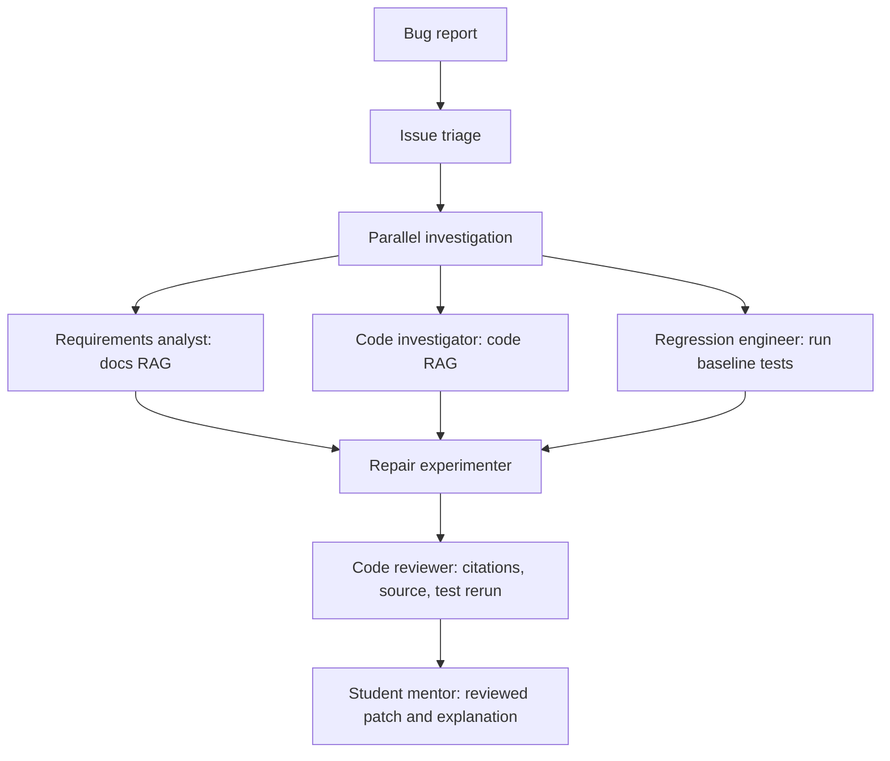

# Software engineering agents — CampusTasks debugging lab

A practical debugging lab using a team of AI agents. Submit an issue, inspect retrieved source code and requirements, reproduce failures, compare repair hypotheses with real tests, and examine a reviewed patch proposal.

The example is an **in-memory Python task-list service**, representing the domain logic behind a task-tracker API. It has deliberately incorrect owner-scoped pagination and unstable ordering. No HTTP server, database, external code host, or deployment is needed.

## Run the agent team

From the repository root, with `google-adk` installed:

```bash
source .venv/bin/activate
export GOOGLE_GENAI_USE_VERTEXAI=FALSE
export GOOGLE_API_KEY="YOUR_GOOGLE_API_KEY"
export SOFTWARE_DEMO_MODEL="gemini-3.5-flash"
cd software_engineering_demo
adk web
```

Select **dev_team**. Alternatively, run `adk run dev_team` from this directory. Choose a Gemini model available to your account using `SOFTWARE_DEMO_MODEL`. Python 3.11 or newer is recommended for a fresh ADK environment. Retrieval and fixture tests need only the Python standard library.

## Start with this prompt

```text
Investigate CampusTasks issue 42. Users see incomplete pages when tasks
from different owners are interleaved, and equal timestamps produce
inconsistent ordering. Use the current API contract, inspect the code,
reproduce the failures, compare the available repair hypotheses, and
show a reviewed minimal patch with actual test results. Explain the
reasoning as if you are mentoring second-year CS students.
```

## Workflow

1. A triage agent turns the bug report into an investigation brief.
2. Three subagents work in parallel: requirements analysis, code investigation, and baseline test reproduction.
3. A repair agent tests partial and combined hypotheses in disposable copies.
4. A reviewer checks cited code, current requirements, the exact diff, and independently reruns the selected experiment.
5. A mentor presents the results, patch, remaining limitations, and discussion questions.



## Capabilities demonstrated

| Capability | Concrete behavior |
| --- | --- |
| Subagents | Seven LLM agents have distinct engineering roles |
| Workflow orchestration | `SequentialAgent` orders stages; `ParallelAgent` runs independent investigations concurrently |
| Code and document RAG | BM25 retrieves Python source, regression tests, issue text, architecture, and API contracts |
| Tool use | Agents read source, execute allowlisted experiments, inspect diffs, and validate citation ranges |
| Shared state | Specialist findings are saved under separate `output_key` values for later stages |
| Hypothesis testing | Partial repairs are evaluated rather than assumed correct |
| Independent review | A second agent verifies evidence and reruns the selected candidate |
| Evidence conflicts | An archived design disagrees with the current contract; agents must follow the superseding document |
| Grounded explanation | The final report cites source lines and distinguishes test observations from assumptions |

ADK's [sequential workflow](https://github.com/google/adk-docs/blob/main/docs/agents/workflow-agents/sequential-agents.md) passes outputs through session state; its [multi-agent patterns](https://developers.googleblog.com/en/developers-guide-to-multi-agent-patterns-in-adk/) describe the orchestration mechanisms used here.

## The exercise and expected results

The current contract requires:

```text
owner filter -> sort by (created_at, id) -> page slice -> copy records
```

The baseline instead sorts globally by timestamp, slices the page, then filters its contents by owner. Other users' tasks consume page slots. Timestamp ties also retain input order because no ID tie-breaker is present. The tests do not demonstrate cross-user exposure; the visible defect is missing/inconsistent results.

Eight regression tests check owner-scoped pagination, tie ordering, later pages, input-order independence, owner isolation, empty results, input validation, and mutation behavior.

| Experiment | Change | Expected result |
| --- | --- | --- |
| `baseline` | No change | 4 failures out of 8 tests |
| `filter_first` | Move owner filtering before sorting/pagination | 2 failures: timestamp ties remain unstable |
| `stable_sort` | Add ID tie-breaker only | 3 failures: global pagination remains incorrect |
| `combined` | Apply both changes | All 8 tests pass |

The minimal combined repair replaces the sort statement with:

```python
ordered = sorted(
    (task for task in tasks if task["owner"] == owner),
    key=lambda task: (task["created_at"], task["id"]),
)
```

The tool returns the exact one-line unified diff that it tested. The existing final owner check remains redundant but harmless; the minimal experiment preserves it.

**This is a controlled repair lab.** The four candidates are pre-authored, allowlisted transformations, not arbitrary agent-generated code. The model investigates, chooses experiments, interprets results, and reviews evidence. It does not have a general shell or file-write tool. No patch is applied to the real sample repository, keeping the exercise repeatable.

## Practical walkthrough

1. Read `sample_repo/docs/issue_42.md` and predict the cause of the incomplete pages.
2. Submit the example prompt and inspect the three parallel specialists in the ADK event trace.
3. Open a `search_knowledge` response and check its code or document citation.
4. Inspect the baseline test output and identify the failing assertions.
5. Compare the partial repairs and explain why each still fails.
6. Compare the passing candidate's diff with the original function.
7. Read the review and identify cases the existing tests do not cover.

## Follow-up prompts

Start a fresh session for an independent exercise; follow-ups otherwise reuse conversation context and rerun the workflow.

```text
Why does fixing the sort order alone fail? Use actual experiment results
and trace Bob's page through the function.
```

```text
Compare the archived design and current API contract. Which is authoritative,
and how should we capture this change in regression tests?
```

```text
Explain the time and auxiliary-space complexity before and after the repair.
Use n for all tasks and m for the requesting owner's tasks. Do not invent timings.
```

```text
Does this prove the system is secure, race-free, and ready for production?
Identify what the available code and tests do and do not establish.
```

```text
What is the maximum supported page size and the p99 latency SLA?
Use only documented evidence and explicitly identify missing requirements.
```

## Tools and execution boundaries

- `list_documents`, `search_knowledge`, and `read_document` operate only inside `sample_repo/`, with exact file/line citations. Retrieval uses 20-line windows, four-line overlap, and lexical BM25 scores; it is not embedding-based semantic search.
- `list_experiments` describes the predefined candidate repairs.
- `evaluate_fix` accepts only a known variant name, copies two explicit fixture files to a temporary directory, applies the selected exact replacement, and runs `unittest` using a fixed command with a 15-second timeout. It returns output, exit code, the tested diff, and source/test hashes.
- Child tests run with isolated Python flags, no shell, and a minimal environment without inherited API credentials. A temporary copy is **not** an operating-system security sandbox; execute only the trusted bundled fixture, not arbitrary untrusted repositories.
- `validate_citations` checks source paths and line ranges and returns passages. Claim support and citation coverage still require reviewer judgment.

If the baseline sort statement changes, repair experiments return an explicit fixture-mismatch error instead of silently evaluating the wrong patch. If you modify requirements or tests for a new exercise, update the predefined candidates and expected results as well.

## Files and state

```text
software_engineering_demo/
├── dev_team/
│   ├── __init__.py
│   ├── agent.py                 # Sequential and parallel agent team
│   ├── retrieval.py             # Code/document BM25 and context reads
│   └── tools.py                 # Fixed test experiments and citation checks
├── sample_repo/
│   ├── task_service.py          # Intentionally buggy baseline
│   ├── tests/test_task_service.py
│   └── docs/                    # Issue, architecture, current/archived contracts
├── tests/test_lab.py            # Tests of the lab tools and expected outcomes
└── README.md
```

State keys are `engineering_task`, `requirements_evidence`, `code_evidence`, `baseline_tests`, `repair_proposal`, `engineering_review`, and `engineering_report`. Parallel agents write distinct keys. Every turn runs the full workflow and refreshes these outputs; this is session working state, not persistent cross-session memory.

## Verify without Gemini

From the repository root:

```bash
python3 -m unittest discover -s software_engineering_demo/tests -v
```

These lab tests pass by checking that the intentionally broken baseline fails as expected, partial repairs remain incomplete, and the combined repair passes. They also verify fixture preservation, code retrieval, citation boundaries, unknown experiment rejection, and changed-fixture detection. No ADK import or API key is required.

To see the intentionally failing baseline directly:

```bash
python3 -B -m unittest discover -s software_engineering_demo/sample_repo/tests -v
```

That second command is expected to exit with failures. Keep the teaching fixture red; the agent evaluates fixes in temporary copies.

## Limits and extensions

The seven-agent workflow makes multiple Gemini calls and can be slower or more costly than a single assistant. It has one independent review pass. Evidence and tool-use rules are prompt instructions, not formal correctness guarantees. No deployment, Git write, external issue creation, or actual pull request occurs.

Possible student extensions include property-based pagination tests, maximum-page-size requirements, a FastAPI adapter, database-backed pagination, hybrid semantic retrieval, and a reviewed patch-application workflow.
